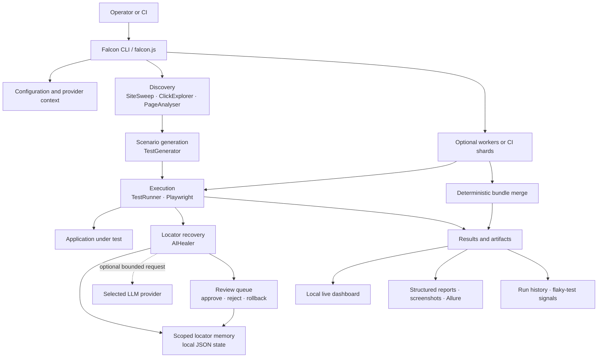
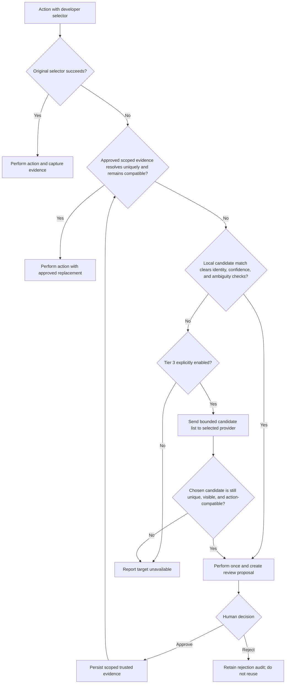

# Falcon Automation

### Self-healing browser tests. Reviewable recovery. Clear release evidence.

Falcon is an open-source test automation framework built on Playwright. It explores a web application, generates interaction scenarios from the live page, and runs them with layered locator recovery. Teams can follow execution in a live dashboard, inspect what changed, and decide which recovered selectors to trust.

**For QA leaders and engineering teams evaluating how to reduce selector maintenance and make test results easier to investigate.**

**Technical preview · Node.js 22+ · Playwright · MIT licensed**

[See the demo](#see-falcon-in-action) · [Try it locally](#quick-start) · [Understand healing](#how-self-healing-works) · [Explore the docs](#documentation)

---

## Why teams evaluate Falcon

A changed button ID can break a test even when the application still works. Repeated locator failures consume maintenance time and make genuine product failures harder to distinguish.

Falcon brings discovery, execution, recovery, and review into one workflow:

| Team need | What Falcon provides |
| --- | --- |
| Spend less time repairing selectors | Retries, approved replacements, local evidence matching, and optional AI-assisted recovery for clicks, text entry, and dropdown selection. |
| Explore an unfamiliar application | A bounded crawl that discovers pages and generates interaction scenarios from their DOM. |
| Understand what a run actually covered | Page-level coverage, explicit reasons for untested pages, and pass/fail/skip results. |
| Review recovery decisions | Scoped locator proposals, approve/reject controls, rollback, and persisted decision history. |
| Investigate unstable tests | Repeated execution, flaky-scenario tracking, quarantine review, and run-history trends. |
| Fit into an existing delivery workflow | CLI execution, GitHub Actions, reports, page-level parallelism, and deterministic sharding. |

Generated scenarios provide a starting point for interaction coverage. Your team still defines the business assertions that establish whether a checkout, calculation, permission, or other customer journey is correct.

<a id="demo"></a>

## See Falcon in action


**What this recording demonstrates:** a browser test starts with a stale search selector, recovers through a stored alternative, fills the real field, and verifies that the feed filters. This historical recording demonstrates locator recovery without an LLM call; it predates the current scoped approval workflow.

[Watch the full recorded UI suite](docs/demo/axonradar-ui-test.mp4) · [Read the demo test](tests/demo/axonradar.ui.spec.js)

<a id="architecture"></a>

## Architecture

Falcon is a Node.js application that runs beside the application under test. Playwright owns the browser session; Falcon coordinates discovery, scenario generation, execution, recovery, review state, and reporting. The application under test does not need a Falcon agent or SDK.



### Runtime layers

| Layer | Main responsibility | Representative components |
| --- | --- | --- |
| **Entry and configuration** | Parse CLI limits and modes, resolve browser and dashboard settings, and create one invocation-scoped LLM provider context when Tier 3 is enabled. | `falcon.js`, `ConfigManager`, `ServiceContainer`, `ProviderContext` |
| **Discovery and analysis** | Crawl reachable pages within origin, page-count, and time limits; inspect the live DOM; identify controls and rule-based DOM issues. | `SiteSweep`, `ClickExplorer`, `PageAnalyser`, `DOMIssueScanner` |
| **Scenario generation** | Convert discovered controls and page metadata into executable interaction scenarios. | `TestGenerator` |
| **Execution** | Run scenarios in Playwright, preserve action semantics for click/type/select, classify outcomes, and emit events. | `TestRunner`, `BrowserManager`, `BaseTest` |
| **Locator recovery** | Retry the original selector, validate scoped approved evidence, compare live candidates locally, and optionally ask an LLM to select a candidate. | `AIHealer`, `AdaptiveRetry`, `LocatorMemory`, `CandidateMatcher`, `SelectorBuilder` |
| **Review and governance** | Hold recovered locator proposals for explicit approval or rejection, retain bounded audit history, and support rollback. | locator review CLI, dashboard locator panel, `HealingTrust` for legacy records |
| **Evidence and reporting** | Produce pass/fail/skip results, coverage gaps, healing events, visual diffs, Allure results, and run-history trends. | `ReportManager`, `HealingReport`, `VisualRegression`, `RunLedger`, `TrendDetector`, `Dashboard` |
| **Scale-out execution** | Schedule independent pages across local workers or deterministic CI shards, journal state changes, and merge shard bundles. | `src/core/parallel/*`, `falcon.js merge` |

Component names above map to the repository so an evaluator can move from this overview to the implementation. See the [project structure in the technical reference](docs/technical-reference.md#project-structure) for the full source layout.

### End-to-end execution flow

1. **Resolve the run context.** Falcon reads the target URL, browser settings, execution bounds, dashboard settings, and optional provider selection. Provider credentials remain in environment variables or the operator's secret manager.
2. **Discover pages.** The crawler starts from the supplied URL and follows eligible navigation within the configured scope. Page and time budgets prevent an open-ended crawl. Cross-origin exploration is disabled unless explicitly allowed.
3. **Analyse the live DOM.** Falcon records interactive element metadata and identifies candidate actions. This is structural analysis, so application-specific business rules are outside this layer.
4. **Generate scenarios.** The generator creates interaction scenarios from discovered controls. Generated scenarios exercise reachable UI behavior; customer-defined assertions still establish business correctness.
5. **Execute in Playwright.** The runner performs each action in a real browser and routes locator failures through the recovery chain described below.
6. **Record evidence and decisions.** Successful interactions can capture scoped element evidence. New recovered selectors become proposals; approved proposals can be reused only inside their recorded scope.
7. **Report the run.** Falcon publishes execution events to the dashboard and writes results, coverage omissions, healing events, screenshots, and history artifacts for review or CI retention.

### Locator-recovery path



A locator identity is scoped by the application, origin, pathname, action, and original selector. Replay checks the current page again before acting. Local matching refuses when identity evidence is insufficient, the best candidate falls below the confidence threshold, or competing candidates are too close. Tier 3 never accepts a model-authored selector: Falcon builds selectors for locally collected candidates, asks the provider for a candidate number, and verifies that candidate against the live page before using it.

A local or Tier 3 recovery can execute once in the current run and then enter review. Only a durable approval of the current proposal permits later trusted reuse. Replacing a proposal changes its ID, which prevents an old approval from authorizing a newly observed candidate. See [How self-healing works](#how-self-healing-works) for operator commands and [Phase 14 correction decisions](docs/architecture/phase-14-correction-decisions.md) for the trust and rollback design.

### Trust and data boundaries

| Boundary | Data flow | Control |
| --- | --- | --- |
| **Falcon ↔ application under test** | Playwright reads rendered pages and performs real clicks, fills, selections, and navigation. | Run autonomous discovery only against local, staging, or disposable environments with suitable test data. |
| **Falcon ↔ LLM provider** | When Tier 3 is enabled, Falcon sends the failed selector, action, description, and a bounded list of eligible candidate descriptors. | Explicit provider selection, endpoint policy, request/time/concurrency budgets, prompt-size limits, and local post-response validation. |
| **Falcon ↔ local persistent state** | Locator evidence, review decisions, flaky history, run history, reports, and screenshots are written locally. | Gitignored runtime paths, bounded schemas and retention, atomic writes/locking where implemented, and customer-controlled filesystem access and retention. |
| **Dashboard ↔ operator** | The local dashboard serves events, results, and review actions. | Loopback binding by default; a token is required for non-loopback binding. Decision records identify the channel, not an authenticated employee identity. |
| **Workers/shards ↔ coordinator** | Workers emit bounded journals or shard bundles; the coordinator validates and deterministically merges them. | Run/commit identity checks, canonical ordering, schema bounds, and merge rejection for incomplete or mismatched inputs. |

With Tier 3 disabled, locator recovery stays local. With Tier 3 enabled, selected element descriptors can contain application labels and text, so customers should treat provider use as a data-processing decision. Full DOM, cookies, storage, environment variables, and complete form contents are not part of the Tier 3 payload. Local files can still contain sensitive application metadata and must be governed accordingly.

### Execution and deployment models

- **Developer evaluation:** one local Node.js process, one Playwright browser, the dashboard on loopback, and JSON/report artifacts on the developer machine.
- **Sequential CI:** `node falcon.js --no-dashboard` runs the bounded pipeline on one runner and returns meaningful process status for the quality gate.
- **Local parallel mode:** `--workers=N` schedules independent pages across browser contexts. Scenarios within a page remain sequential, and mutable session state is not synchronized between workers.
- **CI sharding:** `--shard=I/N --run-id=<id>` creates per-shard bundles. `falcon.js merge` validates all expected bundles and produces the aggregate result; missing or mismatched shards are rejected.
- **Optional integrations:** PostgreSQL tests, Allure generation, dashboard access, and LLM providers are configured separately. They are not required for the local fixture walkthrough.

Falcon is self-hosted in the customer's runtime or CI account. The repository does not include a managed Falcon control plane, centralized identity service, or multi-tenant storage service.

### Architecture documentation

| Design area | Detailed document |
| --- | --- |
| Locator evidence, approval, privacy, concurrency, and rollback | [Phase 14 correction decisions](docs/architecture/phase-14-correction-decisions.md) |
| Parallel workers, sharding, journals, reducers, and trust boundaries | [Phase 16 parallel-execution architecture](docs/architecture/phase-16-parallel-execution.md) |
| Operating workers and shard merges | [Phase 16 operations guide](docs/phase-16-operations.md) |
| Provider interface, endpoint controls, budgets, and telemetry | [Phase 17 pluggable-provider architecture](docs/architecture/phase-17-pluggable-llm-providers.md) |
| Invocation-scoped BYOK profiles and credential isolation | [ADR-0019: Invocation-scoped providers](docs/architecture/maintenance-byok-invocation-scoped-providers.md) |
| Full historical implementation and operational reference | [Historical technical reference](docs/technical-reference.md) |

## Capabilities at a glance

| Capability | Available today | Evaluation boundary |
| --- | --- | --- |
| Browser automation | Playwright-based UI execution | Chromium is exercised in CI; Firefox and WebKit are available through `BrowserManager` but are not CI-validated. |
| Discovery and generation | Page exploration, DOM issue scanning, generated interaction scenarios | Discovery is bounded and can miss unreachable or state-dependent journeys. |
| Locator recovery | Direct retries, scoped approved replay, deterministic matching, optional LLM selection | Recovery depends on available evidence; weak or ambiguous matches can be refused. |
| Visual regression | Screenshot comparison and diff images | Baselines and tolerances need to suit your application and execution environment. |
| API and database testing | API scenario examples and PostgreSQL tests, including TLS/mTLS configuration | Configure endpoints, credentials, fixtures, and assertions for your system. |
| Review and reporting | Live dashboard, structured results, healing history, flaky-test review, Allure integration | Local review channels are not an enterprise identity or role-based access system. |
| Parallel execution | Independent pages across workers; shard bundles merged into a combined result | Scenarios within each page remain sequential; worker session state is not synchronized. |
| Optional AI providers | OpenAI, Anthropic, Gemini, Azure OpenAI, approved OpenAI-compatible endpoints | Integrations have mocked contract tests; live model quality is not certified by those tests. |

<a id="self-healing-architecture"></a>
<a id="scoped-healing-and-review"></a>

## How self-healing works

Falcon tries recovery in order and stops when an action succeeds.

| Stage | What happens | External model required? |
| --- | --- | --- |
| **1 · Retry** | Retry the original selector. A successful interaction can capture element evidence. | No |
| **2 · Approved replay** | Reuse an approved replacement in the same application, origin, pathname, action, and original-selector scope, after checking the live element. | No |
| **2.5 · Local matching** | Compare live candidates with stored element evidence. Require sufficient identity, confidence, and separation from competing candidates. | No |
| **3 · AI-assisted selection** | Ask the selected provider to choose from eligible candidates. Build selectors locally and revalidate the chosen element before acting. | Yes, explicitly enabled |

**Human review controls trusted reuse.** Local matching and AI inference may execute a recovered action in the current run. A successful recovery creates a proposal; it does not automatically become an approved replacement. Approval is scoped to the current proposal and persisted before it takes effect.

Use the dashboard's locator panel or inspect proposals from the CLI:

```bash
node scripts/healing/review.js locator-list
node scripts/healing/review.js locator-show "<identity-key>"
node scripts/healing/review.js locator-approve "<identity-key>" "<proposal-id>"
node scripts/healing/review.js locator-reject "<identity-key>" "<proposal-id>"
```

Copy the identity and current proposal ID from the review output. Old `LocatorStore` entries and legacy healing approvals do not authorize the current scoped replay path.

Local matching needs previously captured evidence with a stable identifier. It is designed to decline when that evidence is missing or ambiguous. Healing also does not establish business correctness: retain assertions that verify the intended outcome.

<a id="installation"></a>

## Quick start

**Prerequisites:** Git, Node.js **22 or newer**, and npm. CI uses Node.js 24.

> **Use a local fixture, staging, or disposable test environment.** Discovery clicks links and buttons and fills real controls. These actions can change application data, even before a recovery proposal is approved. Do not point autonomous exploration at production.

### 1. Install

```bash
git clone https://github.com/eddieir/Falcon-Automation.git
cd Falcon-Automation
npm ci
npx playwright install chromium
cp .env.example .env
```

On Linux environments that need browser system libraries, use `npx playwright install --with-deps chromium`.

### 2. Start the included local application

In the first terminal, from the repository directory:

```bash
npm run fixture:serve -- --port=4173
```

This starts a disposable fixture at `http://127.0.0.1:4173`. Keep it running.

### 3. Run Falcon

In a second terminal, from the same directory:

```bash
node falcon.js --url=http://127.0.0.1:4173 --max-pages=5 --budget-ms=120000
```

Open the dashboard URL printed in the terminal; the default is `http://localhost:3000`. Review the execution events, result totals, and pages omitted by the limits. The default configuration keeps the dashboard available for 60 seconds after completion; increase `DASHBOARD_LINGER_MS` in `.env` before a presentation if needed.

**No API key or database is needed for this walkthrough.** With the fresh configuration above, Tier 3 is disabled. A first run collects evidence; it does not guarantee that a healing event will occur. This fixture walkthrough demonstrates discovery and execution.

To watch Chromium as it runs, set `HEADLESS=false` in `.env`. Stop the fixture with **Ctrl+C** when finished.

### 4. Evaluate your own staging app

Replace the example URL with a test environment you control:

```bash
node falcon.js --url=https://staging.example.com --max-pages=10 --budget-ms=180000
```

For a customer pilot, choose a small set of representative journeys, prepare disposable data and any required authentication, and agree on success criteria before running. Measure coverage gaps, maintenance effort, recovery accuracy, and review effort on that application.

<a id="bring-your-own-provider-key"></a>

## Optional AI: bring your own provider

Falcon's local recovery works without an LLM. Enable Tier 3 when your evaluation needs provider-assisted candidate selection.

| Provider route | Provider ID | Key consideration |
| --- | --- | --- |
| OpenAI | `openai` | Explicit provider selection and credentials required. |
| Anthropic | `anthropic` | Supply a model ID available to your account. |
| Gemini direct API | `gemini` | Supply a model ID; Vertex AI authentication is not implemented. |
| Azure OpenAI | `azure-openai` | API-key authentication; configure resource, host suffix, and deployment. Entra ID is not implemented. |
| OpenAI-compatible endpoint | `openai-compatible` | Requires explicit custom-endpoint opt-in; compatibility depends on the endpoint and model. |

After supplying `OPENAI_API_KEY` through your environment or secret manager:

```bash
node falcon.js --url=https://staging.example.com --llm-provider=openai --llm-model="<model-id>"
```

Replace `<model-id>` with a model available to your account. An API key alone does not enable Tier 3. A conflicting `FALCON_LLM_PROVIDER` setting causes `CONFIG_CONFLICT`; align or unset it before selecting a different provider.

Named profiles store provider settings and a credential environment-variable name, **never the key value**. See the [BYOK operations guide](docs/maintenance-byok-operations.md) for profiles, credential isolation, budgets, and provider switching.

**What leaves the machine:** the failing selector, action, step description, and bounded candidate descriptors such as tag names, selected attributes, and text are sent to the selected endpoint. The prompt defaults to 20 candidates, supports up to 60, and is capped at 8 KiB. Falcon does not send the full page DOM, cookies, storage, or environment variables in this payload. Candidate labels and text can still contain application data.

The provider release was tested against mocked protocols. It does not certify live provider behavior, every vendor model, AWS Bedrock, or other unimplemented authentication methods.

<a id="ci-cd"></a>

## Results your team can review

- **Execution results:** pass, fail, and skip outcomes, plus pages left untested and the reason.
- **Recovery evidence:** which recovery stage was used, proposals awaiting review, and scoped decisions.
- **Visual evidence:** screenshot baselines and differences when visual regression checks are used.
- **Stability signals:** repeated-run classification, quarantine review, and history trends.
- **CI artifacts:** regression reports, scenario reports, and Allure output from the repository workflow.

The [GitHub Actions workflow](.github/workflows/ci.yml) exercises regression checks, browser tests, scenario tests with a seeded PostgreSQL service, and sharding/merge behavior. See [current workflow runs](https://github.com/eddieir/Falcon-Automation/actions/workflows/ci.yml) for commit-specific results.

<a id="running-tests"></a>

### Useful commands

Run these from the repository root after installation:

| Task | Command |
| --- | --- |
| Run without the live dashboard | `node falcon.js --url=http://127.0.0.1:4173 --no-dashboard` |
| Repeat generated scenarios for stability analysis | `node falcon.js --url=http://127.0.0.1:4173 --repeat=3` |
| Run independent pages with two workers | `node falcon.js --url=http://127.0.0.1:4173 --workers=2` |
| Run Node.js regression checks | `npm run test:regression` |
| Run browser regression checks | `npm run test:browser` |
| Run both regression layers | `npm test` |
| Inspect run history | `npm run history:list` |
| Run the recorded third-party UI demo suite | `npm run test:demo` |
| Generate and open an Allure report from existing results | `npm run report` |

Keep the local fixture running for commands targeting port 4173. The recorded third-party suite needs network access and is intentionally excluded from CI. For sharding, merge validation, and worker limitations, see [parallel execution operations](docs/phase-16-operations.md).

## Deployment and data handling

Falcon runs in your own Node.js environment or CI runner. The dashboard binds to loopback by default; a non-loopback bind requires `DASHBOARD_TOKEN`. Use the printed dashboard URL and follow the [configuration reference](.env.example) when enabling remote access.

Local locator memory, reports, screenshots, and history can contain application details. Keep runtime artifacts out of source control and apply your team's access and retention rules. Locator memory includes bounded plaintext fields; hashed attributes do not make the file anonymous. For sensitive evaluations, configure and securely retain a stable `FALCON_LOCATOR_SALT`.

The current review audit records decision channels such as CLI and dashboard, not authenticated individual identities. Evaluate those controls against your organization's requirements before broader adoption. Report vulnerabilities through the [security policy](SECURITY.md).

## Documentation

| Start here | What you will find |
| --- | --- |
| [Environment configuration](.env.example) | Browser, dashboard, database, provider, and history settings. |
| [BYOK operations](docs/maintenance-byok-operations.md) | Invocation-scoped providers, profiles, and credentials. |
| [Provider architecture](docs/architecture/maintenance-byok-invocation-scoped-providers.md) | Provider context and isolation design. |
| [Parallel execution operations](docs/phase-16-operations.md) | Workers, shards, merge behavior, and constraints. |
| [Historical technical reference](docs/technical-reference.md) | The previous detailed README, including demo walkthroughs, operational background, and phase history. |
| [Release history](CHANGELOG.md) | Delivered changes and fixes. |
| [Development plans](docs/PHASE-PLANS.md) | Phase plans and implementation context. |
| [Contributing](CONTRIBUTING.md) | Development and contribution guidance. |

<a id="roadmap"></a>

## Project status and license

Falcon is an **open-source technical preview in active development**. Evaluate it against your own application, assertions, data policies, and CI requirements. The repository's [announcement readiness notes](docs/ANNOUNCEMENT-READINESS.md) document the evidence and limits behind the provider release.

Released under the [MIT License](LICENSE). Created by **Peyman Iravani**.
