# Falcon Automation

### Self-healing browser tests. Reviewable recovery. Clear release evidence.

**The problem every QA team knows.** A developer renames a button ID or reshuffles a page. The application still works, but the test suite turns red. Someone has to trace each broken locator and fix it by hand, and the same work returns with the next release. Over time, maintenance eats the hours meant for new coverage, and real defects hide among failures that were never really failures.

**Why Falcon exists.** Falcon was built to take that repair work off your team without taking the decisions away from it. When a locator breaks, Falcon looks for the same element using evidence from earlier runs, declines to guess when the match is unclear, and records each repair as a proposal that a person approves before it is reused. Local recovery needs no AI provider; model-assisted selection is optional.

Falcon is an open-source test automation framework built on Playwright. It explores a web application, generates interaction scenarios from the live page, and runs them with layered locator recovery. Teams can follow execution in a live dashboard, inspect what changed, and decide which recovered selectors to trust.

**For QA leaders and engineering teams evaluating how to reduce selector maintenance and make test results easier to investigate.**

**Technical preview · Node.js 22+ · Playwright · MIT licensed**

[See the demo](#see-falcon-in-action) · [Try it locally](#quick-start) · [View the architecture](docs/ARCHITECTURE.md) · [Explore the docs](#documentation) · [View the roadmap](#roadmap)

---

## Why teams evaluate Falcon

Falcon brings discovery, execution, recovery, and review into one workflow:

| Team need | What Falcon provides |
| --- | --- |
| Spend less time repairing selectors | Retries, approved replacements, local evidence matching, and optional AI-assisted recovery for clicks, text entry, and dropdown selection. |
| Explore an unfamiliar application | A bounded crawl that discovers pages and generates interaction scenarios from their DOM. |
| Understand what a run actually covered | Page-level coverage, explicit reasons for untested pages, and pass/fail/skip results. Today a pass means the interaction succeeded; reporting verified business outcomes separately is planned for [M1](#roadmap). |
| Review recovery decisions | Scoped locator proposals, approve/reject controls, rollback, and persisted decision history. |
| Investigate unstable tests | Repeated execution, flaky-scenario tracking, quarantine review, and run-history trends. |
| Fit into an existing delivery workflow | CLI execution, GitHub Actions, reports, page-level parallelism, and deterministic sharding. |

Generated scenarios provide a starting point for interaction coverage. Your team still defines the business assertions that establish whether a checkout, calculation, permission, or other customer journey is correct.

<a id="demo"></a>

## See Falcon in action


https://github.com/user-attachments/assets/0640bba0-e755-42a5-9af7-c772f902be06


**What the demo shows:** a saved customer journey passes on a local copy of a real open-source web application (AI-agency, the code behind the AxonRadar site). A UI refactor then renames one test hook. Falcon recovers because the control kept strong identity evidence, a person approves the repair in the dashboard, and a fresh Falcon process reuses it. Falcon also refuses a different change when the control had no stable identity. Recovery uses local evidence only: no API keys and no LLM. The journey's steps were written for the demo; Falcon captured the selector.

[Watch the full demo (1 min 42 s, MP4)](docs/demo/falcon-customer-demo-full-16x9.mp4) · [LinkedIn cut (4:5)](docs/demo/falcon-customer-demo-linkedin-4x5.mp4) · [Reproduce it and see what it proves](docs/demo/CUSTOMER-DEMO.md)

<a id="architecture"></a>

## Architecture guide

Falcon is a self-hosted Node.js application that runs beside the application under test. Playwright owns the browser session, while Falcon coordinates discovery, scenario generation, execution, locator recovery, human review, and reporting.

The architecture guide explains:

- Runtime layers and their source components
- End-to-end execution and locator-recovery flows
- Human approval, trust, and data boundaries
- Local, CI, parallel-worker, and sharded deployment models
- Optional LLM provider isolation and local state ownership

**[Open the complete Falcon architecture guide →](docs/ARCHITECTURE.md)**

## Capabilities at a glance

Every row below is audited, with its status and executable evidence, in the [capability truth table](docs/CAPABILITY-TRUTH-TABLE.md). Anything that table marks `PLANNED` or `UNVERIFIED` is not a shipped feature.

| Capability | Available today | Evaluation boundary |
| --- | --- | --- |
| Browser automation | Playwright-based UI execution | Chromium is exercised in CI; Firefox and WebKit are available through `BrowserManager` but are not CI-validated. |
| Discovery and generation | Page exploration, DOM issue scanning, generated interaction scenarios | Discovery is bounded and can miss unreachable or state-dependent journeys. |
| Locator recovery | Direct retries, scoped approved replay, deterministic matching, optional LLM selection | Recovery depends on available evidence; weak or ambiguous matches can be refused. |
| Visual regression | Screenshot comparison and diff images | Baselines and tolerances need to suit your application and execution environment. |
| API and database testing | API scenario examples and PostgreSQL tests, including TLS/mTLS configuration | Configure endpoints, credentials, fixtures, and assertions for your system. |
| Review and reporting | Live dashboard, structured results, healing history, flaky-test review, Allure integration | Local review channels are not an enterprise identity or role-based access system. |
| Parallel execution | Independent pages across workers; shard bundles merged into a combined result | Scenarios within each page remain sequential; worker session state is not synchronized. |
| Optional AI providers | OpenAI, Anthropic, Gemini, Azure OpenAI, approved OpenAI-compatible endpoints | Integrations have mocked contract tests; live model quality is not certified by those tests. |

<a id="self-healing-architecture"></a>
<a id="scoped-healing-and-review"></a>

## How self-healing works

Falcon tries recovery in order and stops when an action succeeds.

| Stage | What happens | External model required? |
| --- | --- | --- |
| **1 · Retry** | Retry the original selector. A successful interaction can capture element evidence. | No |
| **2 · Approved replay** | Reuse an approved replacement in the same application, origin, pathname, action, and original-selector scope, after checking the live element. | No |
| **2.5 · Local matching** | Compare live candidates with stored element evidence. Require sufficient identity, confidence, and separation from competing candidates. | No |
| **3 · AI-assisted selection** | Ask the selected provider to choose from eligible candidates. Build selectors locally and revalidate the chosen element before acting. | Yes, explicitly enabled |

**Human review controls trusted reuse.** Local matching and AI inference may execute a recovered action in the current run. A successful recovery creates a proposal; it does not automatically become an approved replacement. Approval is scoped to the current proposal and persisted before it takes effect.

Use the dashboard's locator panel or inspect proposals from the CLI:

```bash
node scripts/healing/review.js locator-list
node scripts/healing/review.js locator-show "<identity-key>"
node scripts/healing/review.js locator-approve "<identity-key>" "<proposal-id>"
node scripts/healing/review.js locator-reject "<identity-key>" "<proposal-id>"
```

Copy the identity and current proposal ID from the review output. Old `LocatorStore` entries and legacy healing approvals do not authorize the current scoped replay path.

Local matching needs previously captured evidence with a stable identifier. It is designed to decline when that evidence is missing or ambiguous. Healing also does not establish business correctness: retain assertions that verify the intended outcome.

<a id="installation"></a>

## Quick start

**Prerequisites:** Git, Node.js **22 or newer**, and npm. CI uses Node.js 24.

> **Use a local fixture, staging, or disposable test environment.** Discovery clicks links and buttons and fills real controls. These actions can change application data, even before a recovery proposal is approved. Do not point autonomous exploration at production.

### 1. Install

```bash
git clone https://github.com/eddieir/Falcon-Automation.git
cd Falcon-Automation
npm ci
npx playwright install chromium
cp .env.example .env
```

On Linux environments that need browser system libraries, use `npx playwright install --with-deps chromium`.

### 2. Start the included local application

In the first terminal, from the repository directory:

```bash
npm run fixture:serve -- --port=4173
```

This starts a disposable fixture at `http://127.0.0.1:4173`. Keep it running.

### 3. Run Falcon

In a second terminal, from the same directory:

```bash
node falcon.js --url=http://127.0.0.1:4173 --max-pages=5 --budget-ms=120000
```

Open the dashboard URL printed in the terminal; the default is `http://localhost:3000`. Review the execution events, result totals, and pages omitted by the limits. The default configuration keeps the dashboard available for 60 seconds after completion; increase `DASHBOARD_LINGER_MS` in `.env` before a presentation if needed.

**No API key or database is needed for this walkthrough.** With the fresh configuration above, Tier 3 is disabled. A first run collects evidence; it does not guarantee that a healing event will occur. This fixture walkthrough demonstrates discovery and execution.

To watch Chromium as it runs, set `HEADLESS=false` in `.env`. Stop the fixture with **Ctrl+C** when finished.

### 4. Evaluate your own staging app

Replace the example URL with a test environment you control:

```bash
node falcon.js --url=https://staging.example.com --max-pages=10 --budget-ms=180000
```

For a customer pilot, choose a small set of representative journeys, prepare disposable data and any required authentication, and agree on success criteria before running. Measure coverage gaps, maintenance effort, recovery accuracy, and review effort on that application.

<a id="bring-your-own-provider-key"></a>

## Optional AI: bring your own provider

Falcon's local recovery works without an LLM. Enable Tier 3 when your evaluation needs provider-assisted candidate selection.

| Provider route | Provider ID | Key consideration |
| --- | --- | --- |
| OpenAI | `openai` | Explicit provider selection and credentials required. |
| Anthropic | `anthropic` | Supply a model ID available to your account. |
| Gemini direct API | `gemini` | Supply a model ID; Vertex AI authentication is not implemented. |
| Azure OpenAI | `azure-openai` | API-key authentication; configure resource, host suffix, and deployment. Entra ID is not implemented. |
| OpenAI-compatible endpoint | `openai-compatible` | Requires explicit custom-endpoint opt-in; compatibility depends on the endpoint and model. |

After supplying `OPENAI_API_KEY` through your environment or secret manager:

```bash
node falcon.js --url=https://staging.example.com --llm-provider=openai --llm-model="<model-id>"
```

Replace `<model-id>` with a model available to your account. An API key alone does not enable Tier 3. A conflicting `FALCON_LLM_PROVIDER` setting causes `CONFIG_CONFLICT`; align or unset it before selecting a different provider.

Named profiles store provider settings and a credential environment-variable name, **never the key value**. See the [BYOK operations guide](docs/maintenance-byok-operations.md) for profiles, credential isolation, budgets, and provider switching.

**What leaves the machine:** the failing selector, action, step description, and bounded candidate descriptors such as tag names, selected attributes, and text are sent to the selected endpoint. The prompt defaults to 20 candidates, supports up to 60, and is capped at 8 KiB. Falcon does not send the full page DOM, cookies, storage, or environment variables in this payload. Candidate labels and text can still contain application data.

The provider release was tested against mocked protocols. It does not certify live provider behavior, every vendor model, AWS Bedrock, or other unimplemented authentication methods.

<a id="ci-cd"></a>

## Results your team can review

- **Execution results:** pass, fail, and skip outcomes, plus pages left untested and the reason.
- **Recovery evidence:** which recovery stage was used, proposals awaiting review, and scoped decisions.
- **Visual evidence:** screenshot baselines and differences when visual regression checks are used.
- **Stability signals:** repeated-run classification, quarantine review, and history trends.
- **CI artifacts:** regression reports, scenario reports, and Allure output from the repository workflow.

The [GitHub Actions workflow](.github/workflows/ci.yml) exercises regression checks, browser tests, scenario tests with a seeded PostgreSQL service, and sharding/merge behavior. See [current workflow runs](https://github.com/eddieir/Falcon-Automation/actions/workflows/ci.yml) for commit-specific results.

<a id="running-tests"></a>

### Useful commands

Run these from the repository root after installation:

| Task | Command |
| --- | --- |
| Run without the live dashboard | `node falcon.js --url=http://127.0.0.1:4173 --no-dashboard` |
| Repeat generated scenarios for stability analysis | `node falcon.js --url=http://127.0.0.1:4173 --repeat=3` |
| Run independent pages with two workers | `node falcon.js --url=http://127.0.0.1:4173 --workers=2` |
| Run Node.js regression checks | `npm run test:regression` |
| Run browser regression checks | `npm run test:browser` |
| Run both regression layers | `npm test` |
| Inspect run history | `npm run history:list` |
| Run the recorded third-party UI demo suite | `npm run test:demo` |
| Generate and open an Allure report from existing results | `npm run report` |

Keep the local fixture running for commands targeting port 4173. The recorded third-party suite needs network access and is intentionally excluded from CI. For sharding, merge validation, and worker limitations, see [parallel execution operations](docs/phase-16-operations.md).

## Deployment and data handling

Falcon runs in your own Node.js environment or CI runner. The dashboard binds to loopback by default; a non-loopback bind requires `DASHBOARD_TOKEN`. Use the printed dashboard URL and follow the [configuration reference](.env.example) when enabling remote access.

Local locator memory, reports, screenshots, and history can contain application details. Keep runtime artifacts out of source control and apply your team's access and retention rules. Locator memory includes bounded plaintext fields; hashed attributes do not make the file anonymous. For sensitive evaluations, configure and securely retain a stable `FALCON_LOCATOR_SALT`.

The current review audit records decision channels such as CLI and dashboard, not authenticated individual identities. Evaluate those controls against your organization's requirements before broader adoption. Report vulnerabilities through the [security policy](SECURITY.md).

## Documentation

| Start here | What you will find |
| --- | --- |
| [Architecture guide](docs/ARCHITECTURE.md) | Runtime layers, execution flows, recovery, trust boundaries, deployment, and detailed design links. |
| [Environment configuration](.env.example) | Browser, dashboard, database, provider, and history settings. |
| [BYOK operations](docs/maintenance-byok-operations.md) | Invocation-scoped providers, profiles, and credentials. |
| [Provider architecture](docs/architecture/maintenance-byok-invocation-scoped-providers.md) | Provider context and isolation design. |
| [Parallel execution operations](docs/phase-16-operations.md) | Workers, shards, merge behavior, and constraints. |
| [Historical technical reference](docs/technical-reference.md) | The previous detailed README, including demo walkthroughs, operational background, and phase history. |
| [Capability truth table](docs/CAPABILITY-TRUTH-TABLE.md) | Every promised capability tagged SHIPPED, PARTIAL, PLANNED or UNVERIFIED, with evidence, limits and open gaps. |
| [Competitive evidence register](docs/research/competitive-evidence-method.md) | How competitor claims are sourced, dated and graded; unknown is not the same as absent. |
| [Competitive benchmark protocol](docs/research/competitive-benchmark-protocol.md) | Neutral workloads, scoring rules, the scorer and a local run against Playwright, Selenium and Cypress, with its limits. |
| [Release history](CHANGELOG.md) | Delivered changes and fixes. |
| [Development plans](docs/PHASE-PLANS.md) | Phase plans and implementation context. |
| [Delivery plan](docs/roadmap/ROADMAP.md) | Milestone timeline, decision gates, risks, and the full delivery chart. |
| [Contributing](CONTRIBUTING.md) | Development and contribution guidance. |

<a id="roadmap"></a>

## Roadmap

Falcon is developed in ten milestones, M0 to M9. [GitHub milestones](https://github.com/eddieir/Falcon-Automation/milestones) are the source of truth. Target dates are provisional planning estimates, not release commitments.

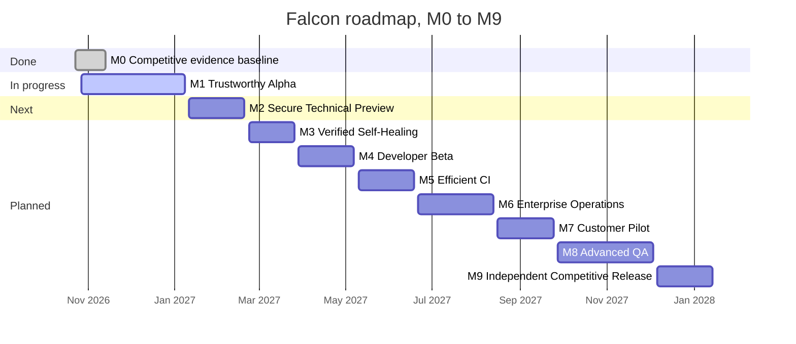

| Milestone | Target | Status | What you'll get |
| --- | --- | --- | --- |
| [M0 — Competitive evidence baseline](https://github.com/eddieir/Falcon-Automation/milestone/1) | 13 Nov 2026 | ✅ Done | A public record of what works today, with evidence behind every claim |
| [M1 — Trustworthy Alpha](https://github.com/eddieir/Falcon-Automation/milestone/2) | 8 Jan 2027 | 🔵 In progress | Results that show green only when your business checks pass, not just when clicks succeed |
| [M2 — Secure Technical Preview](https://github.com/eddieir/Falcon-Automation/milestone/3) | 19 Feb 2027 | 🟡 Next | Safe exploration by default, and isolated test logins for each user role |
| [M3 — Verified Self-Healing](https://github.com/eddieir/Falcon-Automation/milestone/4) | 26 Mar 2027 | ⚪ Planned | Measured, explainable healing that you can review and undo |
| [M4 — Developer Beta](https://github.com/eddieir/Falcon-Automation/milestone/5) | 7 May 2027 | ⚪ Planned | Bring your Playwright tests in, take clean Playwright tests out, and get started in five minutes |
| [M5 — Efficient CI](https://github.com/eddieir/Falcon-Automation/milestone/6) | 18 Jun 2027 | ⚪ Planned | Faster, cheaper CI that runs only the affected tests, within time and AI-cost limits |
| [M6 — Enterprise Operations](https://github.com/eddieir/Falcon-Automation/milestone/7) | 13 Aug 2027 | ⚪ Planned | Team roles, audit trails, and retention controls for larger organizations |
| [M7 — Customer Pilot](https://github.com/eddieir/Falcon-Automation/milestone/8) | 24 Sep 2027 | ⚪ Planned | Results from real design-partner pilots, plus a cost and ROI model |
| [M8 — Advanced QA](https://github.com/eddieir/Falcon-Automation/milestone/9) | 3 Dec 2027 | ⚪ Planned | Accessibility, visual, and API checks inside the same customer journeys |
| [M9 — Independent Competitive Release](https://github.com/eddieir/Falcon-Automation/milestone/10) | 14 Jan 2028 | ⚪ Planned | An independently reviewed release with reproducible benchmarks |

<details>
<summary><b>Delivery plan for each milestone</b>: what "done" means, dependencies, and a timeline of the issues</summary>

Dates inside each milestone are planning estimates and move as work lands. Issue numbers link to the work on GitHub.

#### M0 — Competitive evidence baseline · target 13 Nov 2026 · ✅ Done

**Done when:** Completed on 26 Oct 2026. The competitor evidence register, the benchmark harness with a local run, and the [capability truth table](docs/CAPABILITY-TRUTH-TABLE.md) are published.

**Depends on:** Nothing

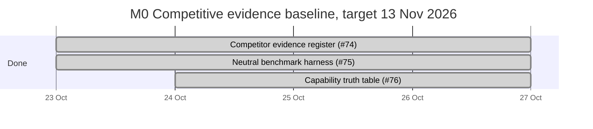

#### M1 — Trustworthy Alpha · target 8 Jan 2027 · 🔵 In progress

**Done when:** A run with no approved business checks can never be reported as fully verified. Approved checks run the same way every time, without an LLM. Discovery finds 2–5 step journeys in local test apps, within set page and action limits.

**Depends on:** M0

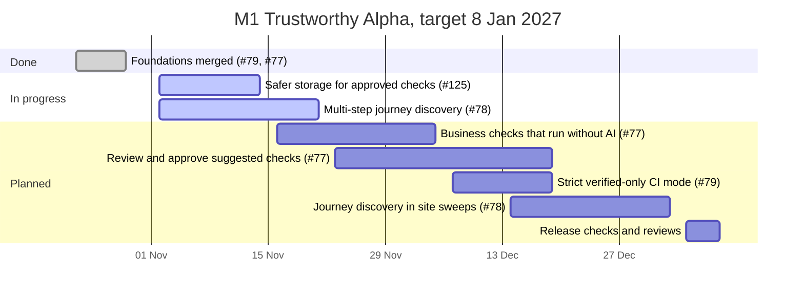

#### M2 — Secure Technical Preview · target 19 Feb 2027 · 🟡 Next

**Done when:** Destructive actions are blocked by default, with a visible reason. Each user role runs in its own browser context, with no shared sessions or leaked secrets. An independent human security review signs off.

**Depends on:** M1, and an independent security reviewer

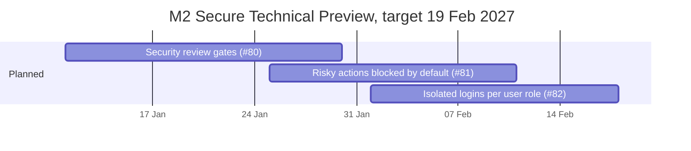

#### M3 — Verified Self-Healing · target 26 Mar 2027 · ⚪ Planned

**Done when:** Healing accuracy, wrong-action and refusal rates are published reproducibly, including on applications the Falcon team did not write. Ambiguous matches are refused, and every repair can be traced and undone.

**Depends on:** M0 and M1

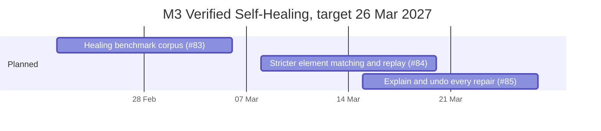

#### M4 — Developer Beta · target 7 May 2027 · ⚪ Planned

**Done when:** Playwright suites import without running their code, and anything unsupported is listed rather than skipped. Exported tests compile and pass. A first run works on Node.js 22 and 24 without an API key.

**Depends on:** M1 and M3

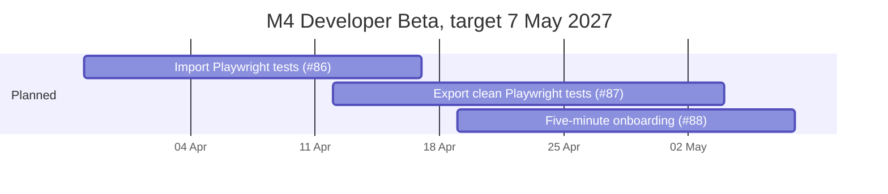

#### M5 — Efficient CI · target 18 Jun 2027 · ⚪ Planned

**Done when:** If the impact of a change is unknown, the full relevant test set runs. A run that hits its budget reports PARTIAL or UNKNOWN, never PASSED. Related failures are grouped without hiding different root causes.

**Depends on:** M1

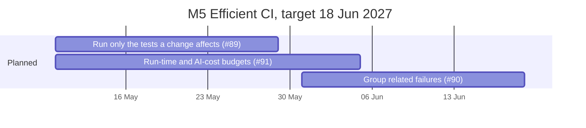

#### M6 — Enterprise Operations · target 13 Aug 2027 · ⚪ Planned

**Done when:** Access is denied by default, and audit records show who did what. Retention, deletion and audit export are integrity-checked, with no credentials or personal data in default artifacts. CI integrations are safe for pull requests from forks.

**Depends on:** M2, and an independent security review

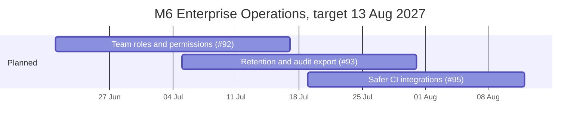

#### M7 — Customer Pilot · target 24 Sep 2027 · ⚪ Planned

**Done when:** Three scoped design-partner evaluations are completed, or the reason they could not be recruited is documented. ROI figures use customer-verified inputs. Packaging decisions have legal sign-off.

**Depends on:** M2, M3, and recruiting design partners

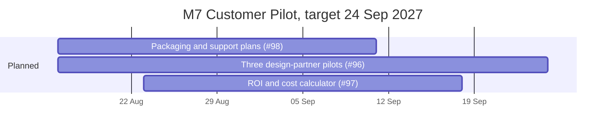

#### M8 — Advanced QA · target 3 Dec 2027 · ⚪ Planned

**Done when:** Accessibility findings are tied to journeys and never presented as certification. Visual baselines change only with explicit approval. UI actions are linked to API evidence, with sensitive data masked.

**Depends on:** M1 and M6

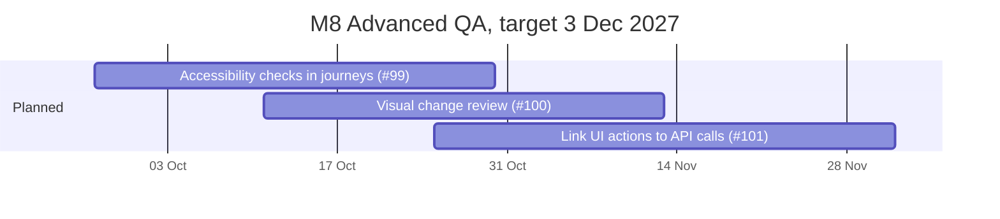

#### M9 — Independent Competitive Release · target 14 Jan 2028 · ⚪ Planned

**Done when:** The benchmark is rerun on the release version. An independent human security and QA review is recorded. Every published claim links to its evidence.

**Depends on:** All earlier milestones, and independent reviewers

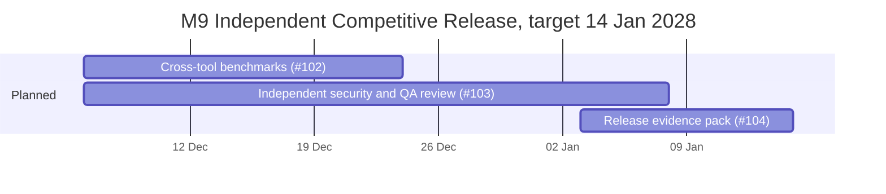

</details>

For the team's working plan, including decisions, risks, and the full delivery chart, see the **[delivery plan](docs/roadmap/ROADMAP.md)**.

## Project status and license

Falcon is an **open-source technical preview in active development**. Evaluate it against your own application, assertions, data policies, and CI requirements. The repository's [announcement readiness notes](docs/ANNOUNCEMENT-READINESS.md) document the evidence and limits behind the provider release.

Released under the [MIT License](LICENSE). Created by **Peyman Iravani**.
