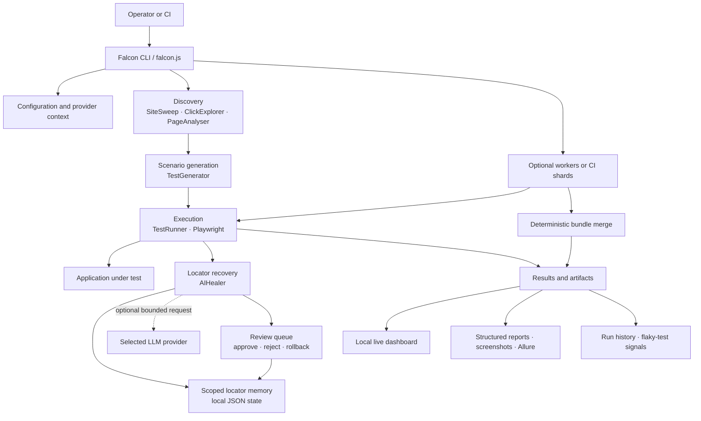
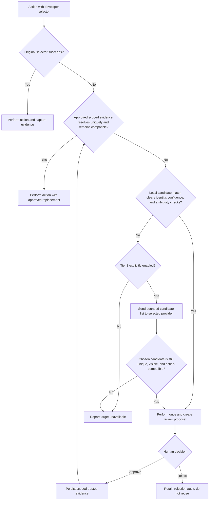

# Falcon Architecture

This document explains how Falcon discovers, generates, executes, heals, reviews, and reports browser tests. It is intended for customers, solution architects, security reviewers, QA leaders, and contributors evaluating the system design.

For the product overview and evaluation walkthrough, return to the [main README](../README.md).

---

Falcon is a Node.js application that runs beside the application under test. Playwright owns the browser session; Falcon coordinates discovery, scenario generation, execution, recovery, review state, and reporting. The application under test does not need a Falcon agent or SDK.

### Runtime layers

| Layer | Main responsibility | Representative components |
| --- | --- | --- |
| **Entry and configuration** | Parse CLI limits and modes, resolve browser and dashboard settings, and create one invocation-scoped LLM provider context when Tier 3 is enabled. | `falcon.js`, `ConfigManager`, `ServiceContainer`, `ProviderContext` |
| **Discovery and analysis** | Crawl reachable pages within origin, page-count, and time limits; inspect the live DOM; identify controls and rule-based DOM issues. | `SiteSweep`, `ClickExplorer`, `PageAnalyser`, `DOMIssueScanner` |
| **Scenario generation** | Convert discovered controls and page metadata into executable interaction scenarios. | `TestGenerator` |
| **Execution** | Run scenarios in Playwright, preserve action semantics for click/type/select, classify outcomes, and emit events. | `TestRunner`, `BrowserManager`, `BaseTest` |
| **Locator recovery** | Retry the original selector, validate scoped approved evidence, compare live candidates locally, and optionally ask an LLM to select a candidate. | `AIHealer`, `AdaptiveRetry`, `LocatorMemory`, `CandidateMatcher`, `SelectorBuilder` |
| **Review and governance** | Hold recovered locator proposals for explicit approval or rejection, retain bounded audit history, and support rollback. | locator review CLI, dashboard locator panel, `HealingTrust` for legacy records |
| **Evidence and reporting** | Produce pass/fail/skip results, coverage gaps, healing events, visual diffs, Allure results, and run-history trends. | `ReportManager`, `HealingReport`, `VisualRegression`, `RunLedger`, `TrendDetector`, `Dashboard` |
| **Scale-out execution** | Schedule independent pages across local workers or deterministic CI shards, journal state changes, and merge shard bundles. | `src/core/parallel/*`, `falcon.js merge` |

Component names above map to the repository so an evaluator can move from this overview to the implementation. See the [project structure in the technical reference](technical-reference.md#project-structure) for the full source layout.

### End-to-end execution flow

1. **Resolve the run context.** Falcon reads the target URL, browser settings, execution bounds, dashboard settings, and optional provider selection. Provider credentials remain in environment variables or the operator's secret manager.
2. **Discover pages.** The crawler starts from the supplied URL and follows eligible navigation within the configured scope. Page and time budgets prevent an open-ended crawl. Cross-origin exploration is disabled unless explicitly allowed.
3. **Analyse the live DOM.** Falcon records interactive element metadata and identifies candidate actions. This is structural analysis, so application-specific business rules are outside this layer.
4. **Generate scenarios.** The generator creates interaction scenarios from discovered controls. Generated scenarios exercise reachable UI behavior; customer-defined assertions still establish business correctness.
5. **Execute in Playwright.** The runner performs each action in a real browser and routes locator failures through the recovery chain described below.
6. **Record evidence and decisions.** Successful interactions can capture scoped element evidence. New recovered selectors become proposals; approved proposals can be reused only inside their recorded scope.
7. **Report the run.** Falcon publishes execution events to the dashboard and writes results, coverage omissions, healing events, screenshots, and history artifacts for review or CI retention.

### Locator-recovery path

A locator identity is scoped by the application, origin, pathname, action, and original selector. Replay checks the current page again before acting. Local matching refuses when identity evidence is insufficient, the best candidate falls below the confidence threshold, or competing candidates are too close. Tier 3 never accepts a model-authored selector: Falcon builds selectors for locally collected candidates, asks the provider for a candidate number, and verifies that candidate against the live page before using it.

A local or Tier 3 recovery can execute once in the current run and then enter review. Only a durable approval of the current proposal permits later trusted reuse. Replacing a proposal changes its ID, which prevents an old approval from authorizing a newly observed candidate. See [How self-healing works](../README.md#how-self-healing-works) for operator commands and [Phase 14 correction decisions](architecture/phase-14-correction-decisions.md) for the trust and rollback design.

### Trust and data boundaries

| Boundary | Data flow | Control |
| --- | --- | --- |
| **Falcon ↔ application under test** | Playwright reads rendered pages and performs real clicks, fills, selections, and navigation. | Run autonomous discovery only against local, staging, or disposable environments with suitable test data. |
| **Falcon ↔ LLM provider** | When Tier 3 is enabled, Falcon sends the failed selector, action, description, and a bounded list of eligible candidate descriptors. | Explicit provider selection, endpoint policy, request/time/concurrency budgets, prompt-size limits, and local post-response validation. |
| **Falcon ↔ local persistent state** | Locator evidence, review decisions, flaky history, run history, reports, and screenshots are written locally. | Gitignored runtime paths, bounded schemas and retention, atomic writes/locking where implemented, and customer-controlled filesystem access and retention. |
| **Dashboard ↔ operator** | The local dashboard serves events, results, and review actions. | Loopback binding by default; a token is required for non-loopback binding. Decision records identify the channel, not an authenticated employee identity. |
| **Workers/shards ↔ coordinator** | Workers emit bounded journals or shard bundles; the coordinator validates and deterministically merges them. | Run/commit identity checks, canonical ordering, schema bounds, and merge rejection for incomplete or mismatched inputs. |

With Tier 3 disabled, locator recovery stays local. With Tier 3 enabled, selected element descriptors can contain application labels and text, so customers should treat provider use as a data-processing decision. Full DOM, cookies, storage, environment variables, and complete form contents are not part of the Tier 3 payload. Local files can still contain sensitive application metadata and must be governed accordingly.

### Execution and deployment models

- **Developer evaluation:** one local Node.js process, one Playwright browser, the dashboard on loopback, and JSON/report artifacts on the developer machine.
- **Sequential CI:** `node falcon.js --no-dashboard` runs the bounded pipeline on one runner and returns meaningful process status for the quality gate.
- **Local parallel mode:** `--workers=N` schedules independent pages across browser contexts. Scenarios within a page remain sequential, and mutable session state is not synchronized between workers.
- **CI sharding:** `--shard=I/N --run-id=<id>` creates per-shard bundles. `falcon.js merge` validates all expected bundles and produces the aggregate result; missing or mismatched shards are rejected.
- **Optional integrations:** PostgreSQL tests, Allure generation, dashboard access, and LLM providers are configured separately. They are not required for the local fixture walkthrough.

Falcon is self-hosted in the customer's runtime or CI account. The repository does not include a managed Falcon control plane, centralized identity service, or multi-tenant storage service.

### Architecture documentation

| Design area | Detailed document |
| --- | --- |
| Locator evidence, approval, privacy, concurrency, and rollback | [Phase 14 correction decisions](architecture/phase-14-correction-decisions.md) |
| Parallel workers, sharding, journals, reducers, and trust boundaries | [Phase 16 parallel-execution architecture](architecture/phase-16-parallel-execution.md) |
| Operating workers and shard merges | [Phase 16 operations guide](phase-16-operations.md) |
| Provider interface, endpoint controls, budgets, and telemetry | [Phase 17 pluggable-provider architecture](architecture/phase-17-pluggable-llm-providers.md) |
| Invocation-scoped BYOK profiles and credential isolation | [ADR-0019: Invocation-scoped providers](architecture/maintenance-byok-invocation-scoped-providers.md) |
| Full historical implementation and operational reference | [Historical technical reference](technical-reference.md) |

