# Falcon delivery plan

This is the team's working view of the roadmap. The [README roadmap](../../README.md#roadmap) is the customer view; it changes only when a milestone changes status or date. This page carries the detail that changes week to week: work packages, decision gates, risks, and tracker housekeeping.

**Source of truth:** [GitHub milestones](https://github.com/eddieir/Falcon-Automation/milestones) for milestone names and target dates; the issues for scope and acceptance criteria. Work windows inside a milestone are planning estimates made on 29 Oct 2026 from the dependencies in the [execution strategy](EXECUTION-STRATEGY.md), [milestone execution matrix](MILESTONE-EXECUTION-MATRIX.md) and [M1 plan](M1-DETAILED-IMPLEMENTATION-PLAN.md). They are not owner-approved commitments.

**Last updated:** 29 Oct 2026.

## Status snapshot

| Milestone | Target | Status | Open / total issues |
| --- | --- | --- | --- |
| [M0 — Competitive evidence baseline](https://github.com/eddieir/Falcon-Automation/milestone/1) | 13 Nov 2026 | Done | 0 / 3 |
| [M1 — Trustworthy Alpha](https://github.com/eddieir/Falcon-Automation/milestone/2) | 8 Jan 2027 | In progress | 2 / 4 |
| [M2 — Secure Technical Preview](https://github.com/eddieir/Falcon-Automation/milestone/3) | 19 Feb 2027 | Waiting on owner decision and reviewer | 3 / 3 |
| [M3 — Verified Self-Healing](https://github.com/eddieir/Falcon-Automation/milestone/4) | 26 Mar 2027 | Planned | 3 / 3 |
| [M4 — Developer Beta](https://github.com/eddieir/Falcon-Automation/milestone/5) | 7 May 2027 | Planned | 3 / 3 |
| [M5 — Efficient CI](https://github.com/eddieir/Falcon-Automation/milestone/6) | 18 Jun 2027 | Planned | 3 / 3 |
| [M6 — Enterprise Operations](https://github.com/eddieir/Falcon-Automation/milestone/7) | 13 Aug 2027 | Planned | 4 / 4 |
| [M7 — Customer Pilot](https://github.com/eddieir/Falcon-Automation/milestone/8) | 24 Sep 2027 | Planned | 3 / 3 |
| [M8 — Advanced QA](https://github.com/eddieir/Falcon-Automation/milestone/9) | 3 Dec 2027 | Planned | 3 / 3 |
| [M9 — Independent Competitive Release](https://github.com/eddieir/Falcon-Automation/milestone/10) | 14 Jan 2028 | Planned | 3 / 3 |

Five evidence-gap issues ([#113](https://github.com/eddieir/Falcon-Automation/issues/113)–[#117](https://github.com/eddieir/Falcon-Automation/issues/117)) are open with no milestone.

## Full delivery chart

All milestones, work packages and decision gates in one view. **Red bars are the critical path**: a slip there moves the milestone date. Diamonds are milestone targets and decision or review gates. `[BLOCKED]` marks work that cannot start until a gate clears.

```mermaid
gantt
    title Falcon delivery plan with decision gates (29 Oct 2026)
    dateFormat  YYYY-MM-DD
    axisFormat  %b %Y
    tickInterval 2month
    todayMarker off

    section M0
    #74 Competitor evidence register             :done,    m0a, 2026-10-23, 2026-10-27
    #75 Neutral benchmark harness                :done,    m0b, 2026-10-23, 2026-10-27
    #76 Capability truth table                   :done,    m0c, 2026-10-24, 2026-10-27
    M0 due 13 Nov (closed 26 Oct)                :milestone, done, m0d, 2026-11-13, 0d

    section M1
    WP-79a Verification classifier (#79)         :done,    w79a, 2026-10-27, 1d
    WP-79s Shard carriage (#79)                  :done,    w79s, 2026-10-27, 1d
    WP-77a Contract schema + store (#77)         :done,    w77a, 2026-10-27, 1d
    #125 ContractStore hardening                 :done,    h125, 2026-10-28, 1d
    GATE Owner decisions D2 D3 D8                :milestone, g1, 2026-11-06, 0d
    WP-77b entry conditions (from #125)          :active, crit, e77b, 2026-11-02, 2026-11-14
    WP-78a State-graph model + guard (#78)       :active,  w78a, 2026-11-02, 2026-11-21
    WP-77b Stage A evaluator (#77)               :crit,    w77b, 2026-11-16, 2026-12-05
    WP-77d Proposal + approval UX (#77)          :         w77d, 2026-11-23, 2026-12-19
    G-03 #115 Allure content assertion           :         g03,  2026-11-23, 2026-12-03
    WP-77c Business fixtures (#77)               :         w77c, 2026-12-07, 2026-12-19
    WP-79b CLI dashboard Allure (#79 reopen)     :crit,    w79b, 2026-12-07, 2026-12-19
    WP-78b SiteSweep integration (#78)           :crit,    w78b, 2026-12-14, 2027-01-02
    WP-M1Q Qualification + reviews               :crit,    m1q,  2027-01-04, 2027-01-09
    Customer discovery track D6 (non-gating)     :         d6,   2026-11-09, 2027-02-20
    M1 due 8 Jan                                 :milestone, m1d, 2027-01-08, 0d

    section M2
    G-01 #113 Real Firefox/WebKit launch         :         g01,  2027-01-11, 2027-01-16
    G-02 #114 TLS PostgreSQL in CI               :         g02,  2027-01-18, 2027-01-23
    #80 Phase 18 security gates [BLOCKED]        :crit,    i80,  2027-01-11, 2027-01-30
    GATE OWNER-24/25 browser posture             :milestone, g2, 2027-01-22, 0d
    #81 Safe autonomous action policy            :crit,    i81,  2027-01-25, 2027-02-11
    #82 Isolated auth journeys [BLOCKED]         :crit,    i82,  2027-02-01, 2027-02-18
    GATE Independent human security sign-off     :milestone, g3, 2027-02-18, 0d
    M2 due 19 Feb                                :milestone, m2d, 2027-02-19, 0d

    section M3
    G-04 #116 Opt-in live provider checks        :         g04,  2027-02-22, 2027-03-04
    #83 Healing benchmark corpus                 :crit,    i83,  2027-02-22, 2027-03-06
    G-05 #117 External-app healing accuracy      :         g05,  2027-03-01, 2027-03-13
    #84 Matching + replay invariants             :crit,    i84,  2027-03-08, 2027-03-20
    #85 Repair explainability + rollback UX      :         i85,  2027-03-15, 2027-03-27
    M3 due 26 Mar                                :milestone, m3d, 2027-03-26, 0d

    section M4
    #86 Playwright TS import + inventory         :crit,    i86,  2027-03-29, 2027-04-17
    #87 Playwright export + migration proofs     :crit,    i87,  2027-04-12, 2027-05-04
    #88 Five-minute onboarding                   :         i88,  2027-04-19, 2027-05-08
    M4 due 7 May                                 :milestone, m4d, 2027-05-07, 0d

    section M5
    #89 Change-impact test selection             :crit,    i89,  2027-05-10, 2027-05-29
    #91 Execution + AI-cost budgets              :         i91,  2027-05-10, 2027-06-05
    #90 Failure clustering + triage notes        :crit,    i90,  2027-05-31, 2027-06-19
    M5 due 18 Jun                                :milestone, m5d, 2027-06-18, 0d

    section M6
    #92 RBAC + actor-attributed review           :crit,    i92,  2027-06-21, 2027-07-17
    #93 (+#94 dup) Retention + audit export      :         i93,  2027-07-05, 2027-07-31
    #95 CI integrations + multi-project          :crit,    i95,  2027-07-19, 2027-08-12
    GATE Human security review                   :milestone, g4, 2027-08-12, 0d
    M6 due 13 Aug                                :milestone, m6d, 2027-08-13, 0d

    section M7
    #98 Packaging + support policy (legal)       :         i98,  2027-08-16, 2027-09-11
    #96 Three design-partner evaluations         :crit,    i96,  2027-08-16, 2027-09-25
    #97 ROI / TCO calculator                     :         i97,  2027-08-23, 2027-09-18
    M7 due 24 Sep                                :milestone, m7d, 2027-09-24, 0d

    section M8
    #99 Accessibility audits in journeys         :         i99,  2027-09-27, 2027-10-30
    #100 Visual regression baselines             :         i100, 2027-10-11, 2027-11-13
    #101 API/UI correlation                      :crit,    i101, 2027-10-25, 2027-12-02
    M8 due 3 Dec                                 :milestone, m8d, 2027-12-03, 0d

    section M9
    #102 Cross-product benchmarks                :         i102, 2027-12-06, 2027-12-24
    #103 Independent security + QA review [BLOCKED] :crit, i103, 2027-12-06, 2028-01-08
    #104 Release readiness dossier               :crit,    i104, 2028-01-03, 2028-01-15
    M9 due 14 Jan 2028                           :milestone, m9d, 2028-01-14, 0d
```

### Critical path

- **M1:** WP-77b entry conditions → WP-77b evaluator → WP-79b strict CLI and reporting → WP-78b discovery in SiteSweep → M1 qualification. It has zero float, and WP-78b falls over the holidays.
- **M2:** #80 security gates → #81 safe-action policy → #82 isolated authenticated journeys. Gated by OWNER-24/25 and by an independent human security sign-off.
- **First externally defensible claim:** #79 → #77 → #83 with external applications (#117) → #102.

## Decisions needed

| Decision | Owner | Needed by | Blocks |
| --- | --- | --- | --- |
| D2 · Treat #77 Stage A as the first slice of Phase 19 | CTO | 6 Nov 2026 | WP-77d |
| D3 · Limit #78 in M1 to unauthenticated, same-origin fixture journeys | CTO | 6 Nov 2026 | WP-78b, #78 closure |
| D8 · Default exit code for zero-assertion runs | CTO | 6 Nov 2026 | WP-79b, M1 qualification |
| OWNER-24/25 · Supported browser posture for authenticated runs | CTO | 22 Jan 2027 | #82, M2, authenticated pilots in M7 |
| Contract an independent human security reviewer | CTO | Nov 2026 | M2 (#80), M6, M9 (#103) |
| D6 · Non-gating customer discovery track from M1 | CTO | Nov 2026 | Early validation before M7 |

## Tracker housekeeping

| Item | Proposed action |
| --- | --- |
| [#79](https://github.com/eddieir/Falcon-Automation/issues/79) closed on 27 Oct, but WP-79b (strict `--require-verified`, dashboard and Allure agreement) is not in the code | Reopen #79, or open a WP-79b issue under M1 |
| [#94](https://github.com/eddieir/Falcon-Automation/issues/94) duplicates [#93](https://github.com/eddieir/Falcon-Automation/issues/93) | Copy #94's extra criteria into #93, then close #94 |
| Evidence gaps #113–#117 have no milestone | Assign G-03 (#115) to M1, G-01 (#113) and G-02 (#114) to M2, G-04 (#116) and G-05 (#117) to M3 |

## Milestone detail

Each chart shows the milestone's issues, including proposed evidence-gap issues. **Waiting** (red) marks work blocked on an owner decision or an independent reviewer.

### M0 — Competitive evidence baseline · target 13 Nov 2026 · Done

**Done when:** Completed on 26 Oct 2026. The competitor evidence register, the benchmark harness with a local run, and the [capability truth table](../CAPABILITY-TRUTH-TABLE.md) are published.

**Depends on:** Nothing

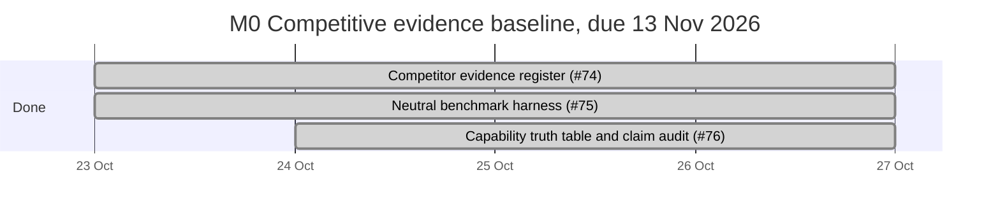

### M1 — Trustworthy Alpha · target 8 Jan 2027 · In progress

**Done when:** A run with no approved business checks can never be reported as fully verified. Approved checks run the same way every time, without an LLM. Discovery finds 2–5 step journeys in local test apps, within set page and action limits.

**Depends on:** M0

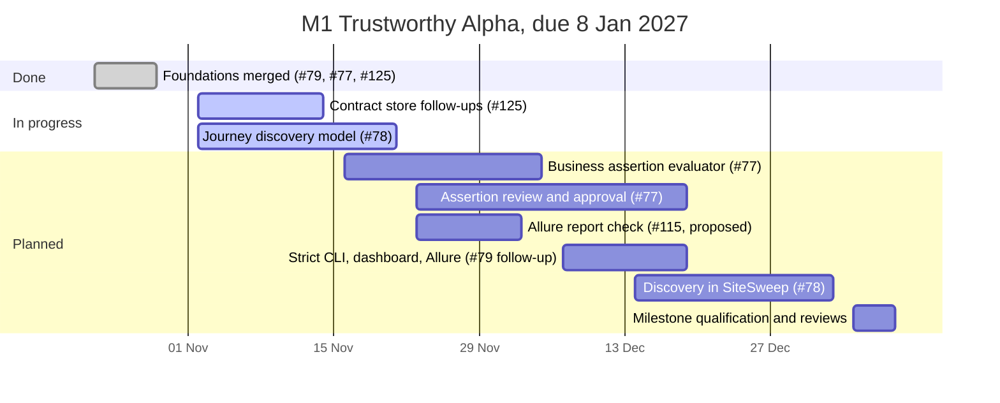

### M2 — Secure Technical Preview · target 19 Feb 2027 · Waiting on owner decision and reviewer

**Done when:** Destructive actions are blocked by default, with a visible reason. Each user role runs in its own browser context, with no shared sessions or leaked secrets. An independent human security review signs off.

**Depends on:** M1, and an independent security reviewer

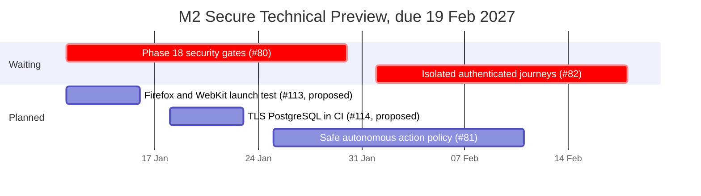

### M3 — Verified Self-Healing · target 26 Mar 2027 · Planned

**Done when:** Healing accuracy, wrong-action and refusal rates are published reproducibly, including on applications the Falcon team did not write. Ambiguous matches are refused, and every repair can be traced and undone.

**Depends on:** M0 and M1

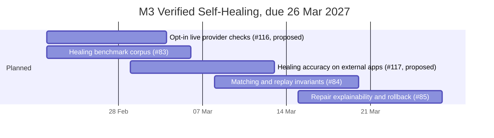

### M4 — Developer Beta · target 7 May 2027 · Planned

**Done when:** Playwright suites import without running their code, and anything unsupported is listed rather than skipped. Exported tests compile and pass. A first run works on Node.js 22 and 24 without an API key.

**Depends on:** M1 and M3

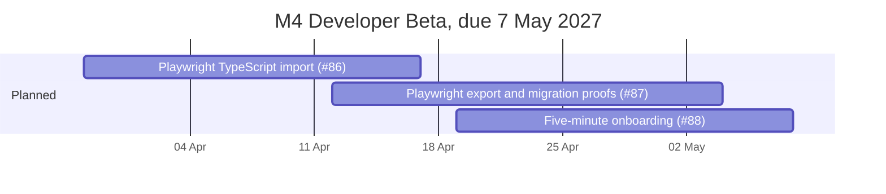

### M5 — Efficient CI · target 18 Jun 2027 · Planned

**Done when:** If the impact of a change is unknown, the full relevant test set runs. A run that hits its budget reports PARTIAL or UNKNOWN, never PASSED. Related failures are grouped without hiding different root causes.

**Depends on:** M1

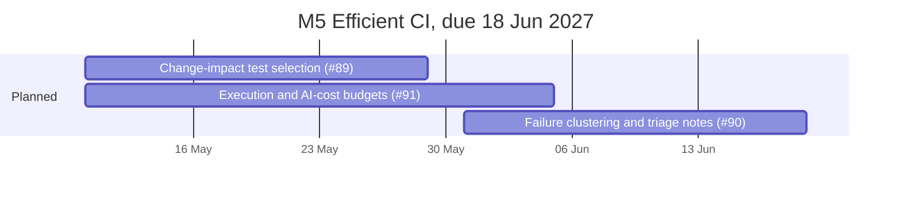

### M6 — Enterprise Operations · target 13 Aug 2027 · Planned

**Done when:** Access is denied by default, and audit records show who did what. Retention, deletion and audit export are integrity-checked, with no credentials or personal data in default artifacts. CI integrations are safe for pull requests from forks.

**Depends on:** M2, and an independent security review

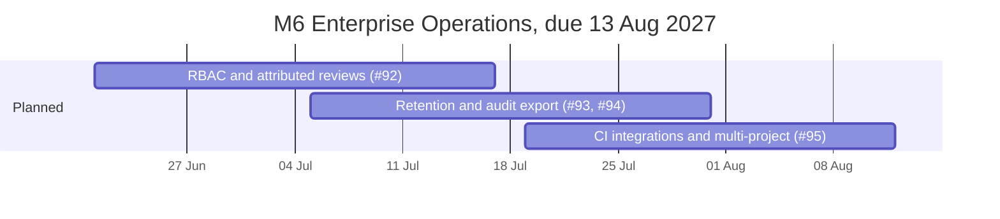

### M7 — Customer Pilot · target 24 Sep 2027 · Planned

**Done when:** Three scoped design-partner evaluations are completed, or the reason they could not be recruited is documented. ROI figures use customer-verified inputs. Packaging decisions have legal sign-off.

**Depends on:** M2, M3, and recruiting design partners

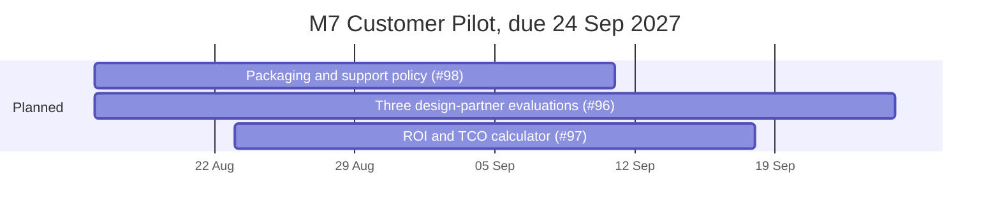

### M8 — Advanced QA · target 3 Dec 2027 · Planned

**Done when:** Accessibility findings are tied to journeys and never presented as certification. Visual baselines change only with explicit approval. UI actions are linked to API evidence, with sensitive data masked.

**Depends on:** M1 and M6

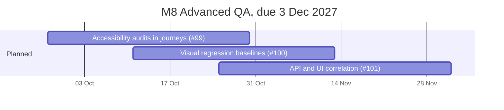

### M9 — Independent Competitive Release · target 14 Jan 2028 · Planned

**Done when:** The benchmark is rerun on the release version. An independent human security and QA review is recorded. Every published claim links to its evidence.

**Depends on:** All earlier milestones, and independent reviewers

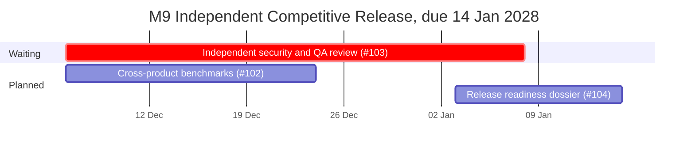

## Top risks

| Risk | Impact | Mitigation |
| --- | --- | --- |
| WP-78b (size L) lands over the holidays with zero float | M1 slips 1–2 weeks | Start WP-78a now beside the WP-77b entry conditions; move WP-78b's replay-evidence slice into M1 qualification if needed |
| Review capacity: every work package needs independent QA, code review and, where triggered, security review | Merges queue up | Keep at most two tasks in flight; book review slots weekly |
| Owner-decision latency (D2, D3, D8, OWNER-24/25) | Blocks the end of M1 and all of M2 | Dated gates on the chart |
| No independent human security reviewer contracted | M2, M6 and M9 stay NO-GO | Start procurement in November 2026 |
| First customer contact is in M7 | Late validation of the core thesis | Run the non-gating discovery track (D6) from November 2026 |
